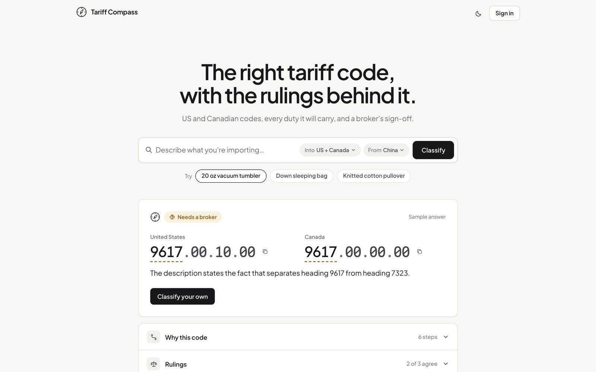
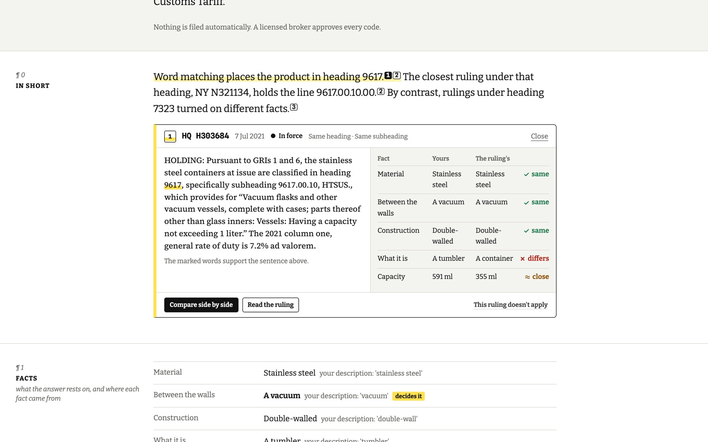
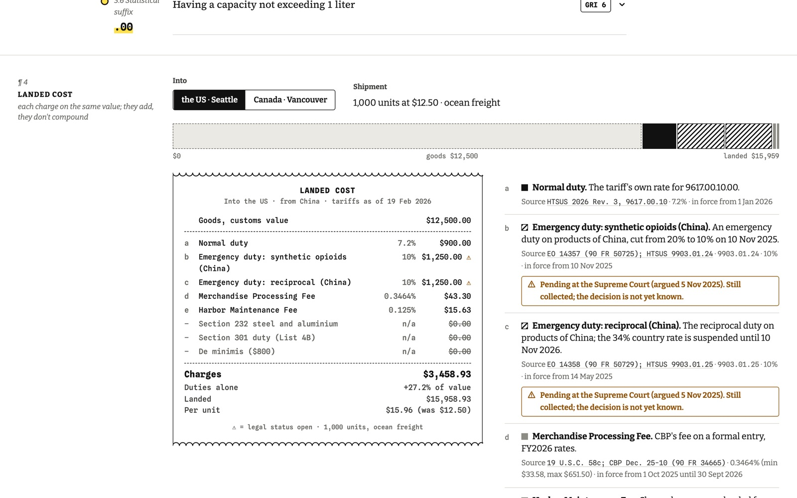
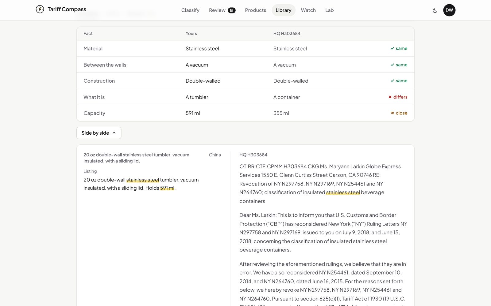
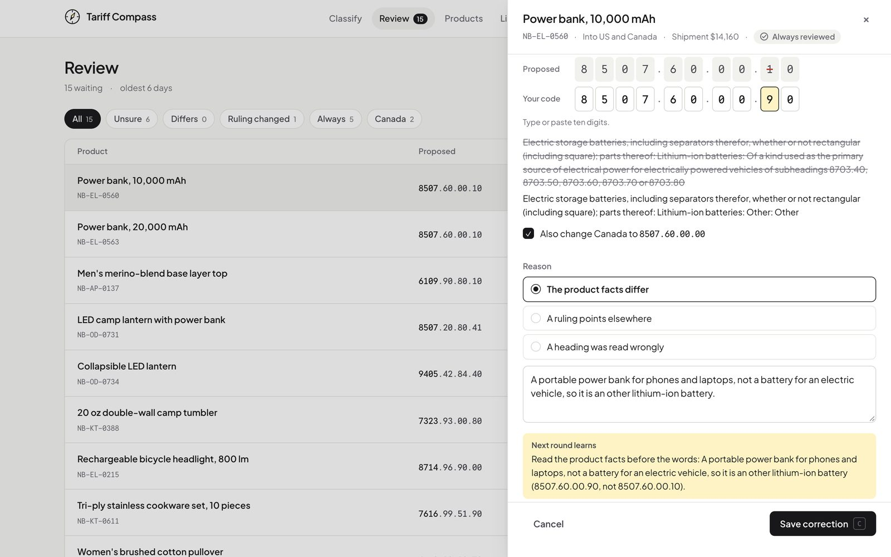
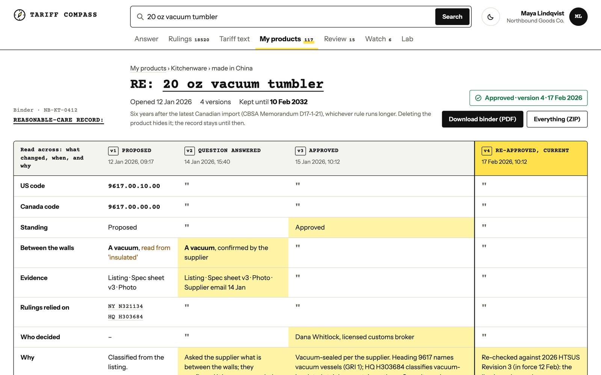
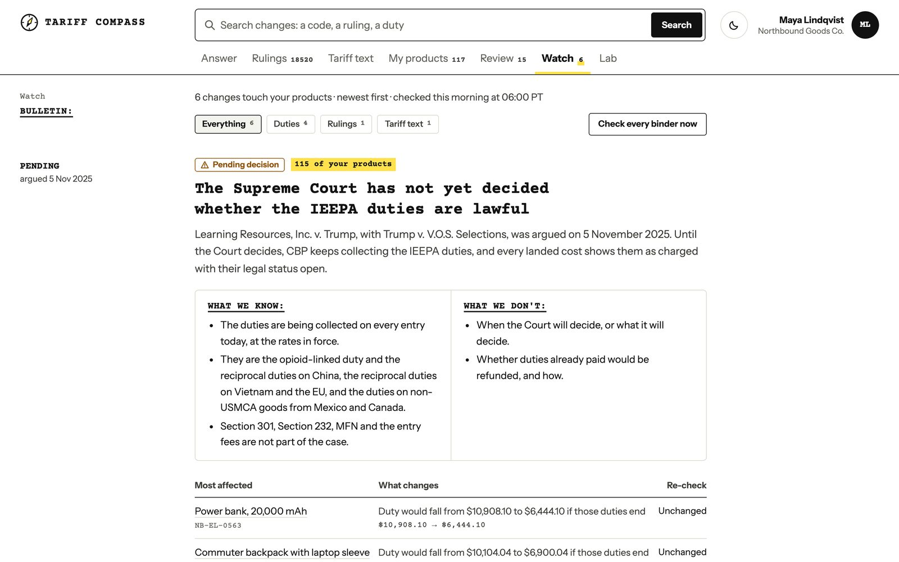
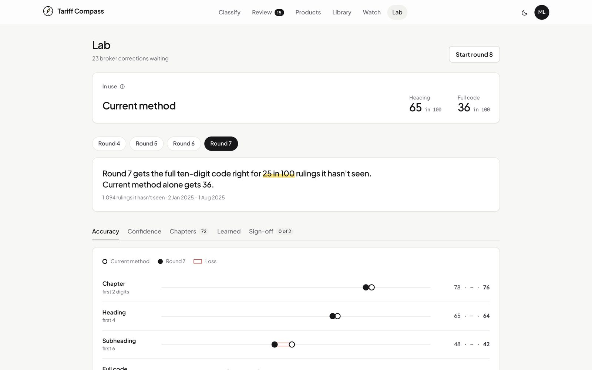
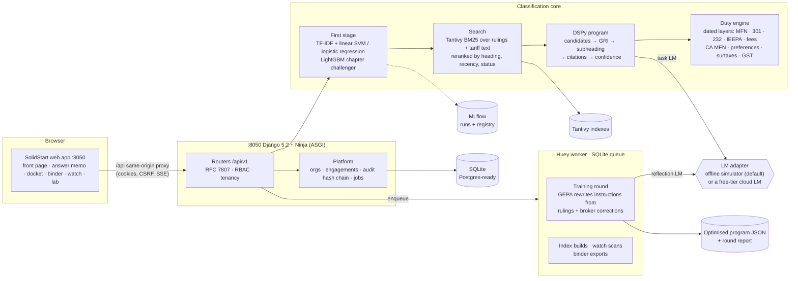

<div align="center">

# Tariff Compass

**The tariff code for US and Canadian imports, with the customs rulings that back it and every duty it will carry.**

Describe a product and Tariff Compass proposes its ten-digit US and Canadian tariff codes, explains why in the shape
of a customs ruling letter, cites the real CBP rulings it relies on and lists every duty on the shipment with its
source and date. When it isn't sure, it says so and sends the product to your broker. Nothing is ever filed for you.

[Problem statement](docs/PROBLEM_STATEMENT.md) · [Architecture](docs/ARCHITECTURE.md) · [API contract](docs/API_CONTRACT.md) · [Data](docs/DATA.md) · [Model card](docs/MODEL_CARD.md) · [Evaluation](eval/RESULTS.md) · [Decisions](docs/adr/) · [Design](frontend/DESIGN.md)

</div>

---

## What it does for importers and brokers

Since 29 August 2025 every parcel into the United States needs a tariff code and pays duty: de minimis is suspended
for every country. A brand like the sample importer, **Northbound Goods Co.** (Vancouver and Seattle; outdoor gear,
small electronics, apparel and kitchenware made in China, Vietnam, Mexico and the EU), now has to answer for about 120
products, each one carrying a stack of duties that changed many times in 2025. One heading can move a $12,500
shipment of tumblers from about $3,400 in duty to several thousand dollars more, and the importer, not the software,
answers for the choice.

| Instead of | Tariff Compass gives you |
|---|---|
| A code copied from a supplier's invoice | A **proposed US and Canadian code** with a plain reason, the classification path rule by rule and the neighbouring headings it set aside |
| "Trust me" | **Numbered citations to real CBP rulings**, each compared with your product fact by fact, and never a revoked ruling as support |
| A duty rate found on a forum | A **landed-cost receipt**: every duty layer with its rate, amount, Chapter 99 number, source and effective date, and the layers that don't apply, with why |
| Email threads with the broker | A **broker docket**: the items that need a professional, in order, with approve, correct (with a reason) or ask; every correction teaches the next training round |
| A folder of PDFs for an audit | A **product binder**: every version of every code, who decided, on what authority, linked into a tamper-evident record and kept five years after the last entry |
| Finding out about a tariff change from an invoice | A **watch bulletin** that flags the products each dated change touches |
| "The AI is 95% accurate" | A **Lab** that measures every training round on rulings it hasn't seen, shows what is actually in use, and needs two signatures before anything changes |

The sample broker firm, **Driftwood Customs Brokers**, reviews Northbound's US and Canadian entries inside the same
product.

## Gallery

Every screen uses the sample organisations (Northbound Goods Co. and Driftwood Customs Brokers) with the clock set to
**Thursday 19 February 2026**, 10:30 a.m. Vancouver time. More screens, dark mode and phone layouts are in
[`docs/screenshots/`](docs/screenshots/).

| | |
|---|---|
|  |  |
| **Front page.** One box, the 97 chapters of the tariff as the horizon, and three sample products to try without signing in. | **The answer.** A ruling-shaped memo; citation 1 unfolds in place with the ruling's holding and a fact-by-fact comparison. |
|  |  |
| **Landed cost.** Every layer with its source and date; the IEEPA lines are marked as pending at the Supreme Court. | **Compare.** Your product against a cited ruling, side by side, fact by fact. |
|  |  |
| **Broker docket.** A correction typed digit by digit, with a required reason and what the next round will learn. | **Product binder.** Every version of the code, who decided and on what authority, kept until 2031. |
|  |  |
| **Watch.** Dated changes and the products they touch, the pending IEEPA case first. | **Lab.** What is in use, and every training round measured against it on rulings it hasn't seen. |

## Features

**Classify.** Type a description, paste a listing, drop a spec sheet (PDF) or a photo, choose *Into* (US, Canada or
both) and *Made in*. The answer opens with a holding band: the US HTSUS and Canadian Customs Tariff ten-digit codes,
a confidence word (**Strong match** or **Needs a broker**, never a percentage), the one fact that would decide it
when it is unsure ("Is there a vacuum between the walls, or only air?") and, where a neighbouring code is plausible,
**Also possible** with the condition under which it would apply. Answering the question re-runs the classification.
"Strong match" is held to a strict statistical bar; today word matching never reaches it, so every answer says
**Needs a broker** and a broker confirms each code.

**The answer as a ruling letter.** Below the codes the memo follows the shape of a CBP ruling: ¶0 *In short*, ¶1
*Facts* (each with where it came from: your words, the spec sheet, the photo), ¶2 *Issue*, ¶3 *Law and analysis*
(Section → Chapter → Heading → Subheading → statistical suffix, the General Rule of Interpretation applied at each
step and why each neighbour was set aside), ¶4 *Landed cost* and ¶5 *Authorities cited*. Every sentence carries
numbered citations; each opens in place with the ruling's holding, status and a fact-by-fact comparison, and
**Compare side by side** opens a two-pane view of your product against the letter.

**Landed cost.** For each country and the shipment (value, quantity, transport): MFN, Section 301, Section 232 on
steel and aluminium content, the IEEPA duties, the Merchandise Processing and Harbor Maintenance fees, and in Canada
the MFN or preferential rate, surtaxes and GST. Each line shows its rate, amount, a plain reason, its Chapter 99
number, its source and its effective date; the layers that don't apply are listed with why (for example "List 4B:
suspended", "De minimis: suspended for all countries since 29 Aug 2025"). USMCA/CUSMA origin questions appear where a
preference could be claimed.

**Rulings and tariff text.** Search 18,000+ CBP rulings with each letter's status (in force, modified, revoked) and
holding, and read the US and Canadian tariff as an indented outline with rates beside each line.

**Broker docket.** Driftwood's queue of 15 items in the order to work them: unsure answers, answers that differ from
the last code, products whose ruling changed and always-review rules (lithium cells, steel or aluminium content,
entries over $25,000). The open row unfolds into a decision record: **approve**, **correct** (type the ten digits
into a pin input, pick the reason, write the lesson) or **ask the importer**. Keyboard: `J`/`K` move, `A` approve,
`C` correct, `Q` ask. Each correction shows "what the next training round will learn" and joins its training set.

**Product binder.** Each product's history as a revision matrix (proposed → question answered → approved →
re-checked), with the US and Canadian codes, the evidence, the rulings relied on and who decided, each version
linked to its entry in the activity record. Download it as a PDF or a ZIP with the evidence. Retention runs five
years from the latest entry (the 20 oz tumbler's binder is kept until 2031).

**Watch.** A dated bulletin of changes to the tariff, the duty layers and the rulings: the pending Supreme Court IEEPA
case (what is known and what isn't), 2026 HTSUS Revision 3, the Section 301 increase on lithium-ion batteries,
Canada's steel derivative surtax and the cut to the opioid-linked IEEPA duty, each with the products it touches and
the change in their duty.

**Lab.** For the compliance lead, in plain words: what is answering questions now, every training round's accuracy
by depth on rulings it hasn't seen, what the confidence word has meant in practice (as dots out of a hundred),
accuracy by chapter, drift, what each round learned from brokers, and a sign-off sheet with the five checks. A round goes live only after it passes
five checks and two different people sign it.

**Platform.** Organisations with roles (importer, broker, compliance, admin), brokers working inside their clients'
organisations through engagements, invitations, settings (defaults, your broker, records, always-review rules) and an
activity record whose hash chain can be verified with one press.

## How it works

```
your words ─▶ first stage ─▶ search ─▶ DSPy program ─▶ citations ─▶ duties ─▶ answer + binder
              (word matching:  (Tantivy     (5 modules,        (rulings     (dated
               top-5 headings)  BM25)        GEPA-optimised)    compared)    layers)
```

1. **First stage, word matching.** TF-IDF features (word 1–2 grams, character 3–5 grams) into a calibrated linear
   SVM rank the 490 headings that have rulings and pass the top five, each with a probability and the words that
   pushed it up. A LightGBM chapter classifier and a logistic regression are the challengers. It takes under a
   millisecond on a laptop CPU.
2. **Search.** Tantivy BM25 over the rulings and the tariff text, restricted to the candidate headings plus contrast
   candidates, reranked by heading agreement, recency and status. A revoked ruling is never returned as support.
3. **DSPy program.** Five modules in order: *CandidateHeadings* → *GriReasoning* → *ChooseSubheading* (US and Canada)
   → *SelectCitations* → *Confidence*. Its instructions are optimised with **GEPA**, using rulings and broker
   corrections as labelled examples and newer rulings for validation and test. Each training round is reproducible
   from its seed, budget and data snapshot hash.
4. **Citations.** Each sentence cites rulings under the chosen heading; one ruling from a neighbouring heading is
   cited for contrast. The compare view lines up the product's facts with the letter's.
5. **Duties.** The duty engine stacks the layers in force on the snapshot date (33 layers, each with a source, a
   Chapter 99 number and an effective date) and refuses any layer without them.

What answers in the product today is decided in the Lab: **word matching** (the calibrated first stage with the
closest ruling's line under its top heading) until a training round of the program passes all five checks and is
signed live. See [Accuracy](#accuracy-measured-on-rulings-it-hasnt-seen).

## Architecture



The Lab reads which training round is live; until one is, the classifier answers with word matching. Every response
carries `X-Tariff-Compass-Now` from the one demo clock. Details and latency budgets:
[`docs/ARCHITECTURE.md`](docs/ARCHITECTURE.md).

## Tech stack

| Area | Technology |
|---|---|
| API and platform | Python 3.13, **Django 5.2** + **Django Ninja** 1.8 (Pydantic 2, camelCase on the wire, RFC 7807 errors), SQLite (Postgres-ready), Argon2 passwords, session cookies with CSRF, rate limits, structlog, Prometheus metrics |
| Background jobs | **Huey** 3.5 with SQLite storage: training rounds, index builds, watch scans, binder exports; progress over SSE |
| Search | **Tantivy** 0.27 (Rust, Python bindings): BM25 over rulings and tariff text, English stemming, snippets; our own reranker |
| AI core | **DSPy** 3.5 (five-module program) optimised with **GEPA** 0.1; a deterministic offline LM simulator; Groq, Gemini or OpenRouter free tiers when a key is set |
| Classical ML | **scikit-learn** 1.9 (TF-IDF, logistic regression, linear SVM, temperature calibration), **LightGBM** 4.7, **Optuna** 5, **MLflow** (local tracking and registry), PSI drift |
| Documents | pypdf (spec sheets), ReportLab (binder PDF) |
| Web | **SolidStart** 1.5 (SolidJS, TypeScript), **Ark UI** 5.40 with Park UI-style recipes (`tailwind-variants`), **Tailwind CSS** 4.1, TanStack Table, GSAP Flip; Bitter, Source Serif 4 and Spline Sans Mono, self-hosted |
| Quality | pytest, Ruff, mypy, `tsc`, Vitest, an evaluation harness with gates, GitHub Actions CI |

Pinned versions and why each was chosen: [ADR 0001](docs/adr/0001-toolchain-and-feasibility.md).

## Quick start (offline, no accounts, no keys)

You need Python 3.13, Node 21.7.1 (`frontend/.nvmrc`), `make` and, on macOS, `brew install libomp` for LightGBM. No
Docker.

```bash
make setup        # venv from the pinned lock, web app (npm ci), .env, migrate, seed
make api          # API on http://127.0.0.1:8050 (health: /health)
make worker       # background jobs (or set HUEY_IMMEDIATE=true to run them inline)
make web          # production build of the web app on http://127.0.0.1:3050
```

`make dev` runs the API, the worker and the web dev server together; `make stop` stops every Tariff Compass process.

Open http://127.0.0.1:3050 and try one of the three sample products without signing in (a 20 oz vacuum tumbler
from China, a down sleeping bag from Vietnam and a knitted cotton pullover from Vietnam; samples are illustrations,
and measured accuracy is below), or sign in with a one-press
sample sign-in: **importer** Jordan Tse, **broker** Dana Whitlock (Driftwood Customs Brokers), **compliance** Maya
Lindqvist or **admin** Priscilla Mensah. Every sample account uses the password `compass-sample-2026` (sample data
only).

**The demo day.** The app believes it is **Thursday 19 February 2026**, 10:30 a.m. in Vancouver
(`TARIFF_COMPASS_DEMO_TODAY`, `TARIFF_COMPASS_DEMO_TIME`; `real` uses the wall clock). `make seed` builds:

- **Northbound Goods Co.** with 117 products and their binders (the 20 oz vacuum tumbler NB-KT-0412 has four
  versions), entries, evidence files and six dated watch items;
- **Driftwood Customs Brokers** with a docket of 15 items and 23 corrections waiting for the next training round;
- the Lab's training rounds 4 to 7, loaded from the reports the real runs produced, labelled with the LM that wrote
  them.

**Full data (optional).** Committed fixtures run the tests and the demo. `make fetch-data` downloads the full rulings
corpus (about 290 MB transfer, 100 MB kept), the HTS and Canada's T2026 into the git-ignored `data/`, then
`make build-index` and `make train` rebuild the indexes and the first stage.

**Optional live language model.** Set `LLM_FAKE=false` and a free-tier key (`GROQ_API_KEY`, `GEMINI_API_KEY` or
`OPENROUTER_API_KEY`) in `.env`. Without one, a deterministic offline simulator runs the whole program, GEPA included.

## Accuracy, measured on rulings it hasn't seen

Every figure below is from [`eval/RESULTS.md`](eval/RESULTS.md) (`make eval`), measured on the frozen test set: the
**1,094 newest labelled CBP rulings** (2 Jan to 1 Aug 2025), newer than anything any model, tuning step or training
round learned from. Labels are the codes each letter itself holds. Splits are by date: train before April 2024,
validation to the end of 2024, test after.

**What is in use: word matching.** The calibrated first stage, with the closest ruling's line under its top heading,
answers in the product. The GEPA-optimised DSPy program (round 7) is a **challenger** that did not beat it on the
offline simulator, so it is not promoted.

| System | LM | Chapter | Heading | 6 digits | 10 digits |
|---|---|---|---|---|---|
| **Word matching** (in use) | none | **78.1%** | **65.4%** | **48.4%** | **36.1%** |
| DSPy program, round 7, GEPA-optimised (challenger) | offline simulator | 76.0% | 63.6% | 42.1% | 24.8% |
| DSPy program, unoptimised | offline simulator | 76.0% | 63.6% | 36.2% | 14.3% |

Ten-digit accuracy counts the 1,064 test rulings whose letter holds a ten-digit code.

- **The offline simulator is not a language model.** It is a deterministic, documented stand-in
  (`backend/tariffcompass/adapters/lm_sim.py`, [ADR 0003](docs/adr/0003-dspy-program-gepa-and-the-offline-simulator.md))
  that follows only the rules written into the program's instructions, so GEPA really changes its behaviour. Its
  numbers measure the pipeline and the optimisation loop. With it, GEPA lifts the program at six and ten digits
  (36.2% → 42.1% and 14.3% → 24.8%) but the program still loses to word matching. No live-LM numbers have been
  produced yet.
- **The honest test is a real LM.** With a free Groq or Gemini key:

  ```bash
  export LLM_FAKE=false GROQ_API_KEY=…     # or GEMINI_API_KEY=… with LITELLM_MODEL=gemini/gemini-2.5-flash
  export LITELLM_MODEL=groq/llama-3.3-70b-versatile LITELLM_REFLECTION_MODEL=gemini/gemini-2.5-flash
  cd backend && .venv/bin/python manage.py optimize --round 8 --seed 8 --budget 300 --train-n 60 --val-n 40
  cd .. && make eval
  ```

  The round lands in the Lab as a challenger with "Answers written by" naming the LM, and `eval/RESULTS.md` gets a
  table for that LM next to the simulator's.
- **The first stage** gets the right heading in its top five 83.3% of the time and the right chapter in its top three
  91.8% (linear SVM chosen on validation before the test set was read; logistic regression 82.6% and 92.7%; LightGBM
  chapters 88.3% top-3). Calibration error on the test set: 0.098.
- **The confidence word.** "Strong match" starts only at the lowest threshold where the one-sided 95%
  Clopper-Pearson lower bound of validation precision (six digits, 463 held-out validation rulings) is at least
  0.90. An earlier rule used the point estimate: it gave 91.5% on validation but only 86.5% on the test set, at
  17.6% coverage. Under the stricter rule no threshold qualifies for word matching (the best lower bound is 0.874,
  121 right of 131), so **it never says "Strong match" and every answer says "Needs a broker"**. On the test set
  that is 0 Strong and 1,094 Needs a broker; the first guess was wrong in 564 of them, so a broker's review is
  doing real work.
- **Citations in use.** 3,282 of 3,282 supporting citations from word matching share the answer's heading; revoked
  rulings cited as support: 0. (Round 7, the challenger: 3,180 of 3,188.)
- **Landed cost** is exact to the cent on all 20 hand-checked products; a simulated tariff revision flags exactly the
  6 affected products, and no others; the first stage answers in about 0.7 ms at p95 and a full offline answer in
  under 100 ms.
- **Drift.** The chapter mix of the newest rulings has moved from training's (PSI 0.34, a large shift).

**Two kinds of gate** (`eval/gates.toml`). **Release gates** judge what is in use and fail the build and CI: the
first stage's top-k, the in-use confidence word, the in-use citations, landed cost, drift detection and latency.
**Promotion checks** decide whether a challenger round may go live: failing one means "not promoted" (the round
stays a challenger and the Lab shows why), not a build failure. Round 7 is not promoted: it loses to word matching at
heading and full code, and its own "Strong match" is right 87.5 times in 100, short of 90.

**Final gate result.** Every release gate passes except one: *In use: "Strong match" right at least 90 times in 100
(and said at all)*. It fails because the word is never said. The threshold was not loosened, so CI's evaluation
step stays red until a better first stage or a real-LM round clears it.

**How the test set was used.** The first stage's test set was read once, at the end. The program's training rounds
were run several times while the pipeline was being fixed, and each run printed its test figures. The fixes came
from the training logs, the saved instructions, the validation window and the sample catalogue, never from test
errors, and no gate or threshold was changed for them. The confidence word's lower-bound rule was adopted after an
earlier look at the test set and fixed on validation; the test set was then read once more, for that word only. So
the test set has been read many times, and every look is counted in `eval/RESULTS.md` and the model card. A fresh
window of rulings issued after August 2025 is the clean check.

**Phrasing check** (paraphrases of the public samples, written before any result): the tumbler lands on its heading
in 3 of 6, the down sleeping bag 5 of 5, the knitted pullover 4 of 5, and the former bicycle-headlight sample 0 of 5
(see Limitations).

Full tables, per-depth calibration and every gate: [`eval/RESULTS.md`](eval/RESULTS.md). The first stage's model card:
[`docs/MODEL_CARD.md`](docs/MODEL_CARD.md).

## Compliance

Tariff Compass is designed to support the importer's legal duties. It is not legal advice, not a binding ruling and
not certified by anyone, and **it never files anything**: a licensed broker approves every code before it is used on
an entry.

| Duty | What Tariff Compass does |
|---|---|
| **Reasonable care, 19 U.S.C. 1484** | Every code comes with its reason, the GRI at each step, the rulings relied on (compared fact by fact, as 19 CFR 177.9(b)(1) asks) and who approved it |
| **Record keeping, 19 CFR Part 163** | Binders are append-only and kept five years from the latest entry (19 CFR 163.4), so entries in early 2026 are kept to 2031 and later ones to 2032; PDF and ZIP export with the record's fingerprint on every page |
| **Canada: corrections and records** | CBSA Memorandum D11-6-6 (correct within 90 days of reason to believe) and D17-1-21 (keep records six years) are shown where they apply |
| **Canada: advance rulings and policy** | A binder holds what an advance ruling request needs (D11-11-3); D10-0-1 (parts and accessories) and D10-14-64 (Bluetooth goods) are cited where they decide a product |
| **Duties as of a date** | Each of the 33 duty layers carries its authority, Chapter 99 number, effective dates, legal status and sources. The IEEPA duties are shown as charged and **pending at the Supreme Court** (argued 5 Nov 2025, undecided on 19 Feb 2026); the product never states an outcome. The suspended part of the China reciprocal rate is shown as suspended until 10 Nov 2026, and FY2026 fees as in force to 30 Sep 2026 |
| **People in the loop** | Unsure answers, changed codes, changed rulings and always-review rules go to a licensed broker; a training round needs two signatures; every sensitive action is in a SHA-256 hash-chained activity record |
| **Platform security** | Argon2 passwords, short sessions, CSRF, rate limits, security headers, RBAC by permission, tenant isolation tested (cross-tenant ids return 404) |

## Data and licences

| Source | Use | Licence |
|---|---|---|
| **CBP CROSS rulings** (18,136 NY and HQ letters, Jan 2014 to Aug 2025) via a public mirror on Hugging Face (`orlandowhite/hts-cross-rulings`) | Search, citations, labelled training and test examples | Works of the US government, public domain (17 U.S.C. 105). We keep only CBP's own fields and the letter, link every ruling to rulings.cbp.gov, and **re-derive every label from the letter's own holding** (10,556 labelled examples; 509 letters whose holding disagrees with the mirror's code are dropped as labels and never cited) |
| **USITC Harmonized Tariff Schedule**, 2026 Revision 3 (in force from 12 Feb 2026) | Tariff text, rates, Chapter 99 | US government work, public domain |
| **CBSA Customs Tariff T2026** (effective 1 Jan 2026) | Canadian tariff items, MFN and preferential rates | Reproduced under the Reproduction of Federal Law Order; not an official version |
| **Duty layers** (33, verified as of 19 Feb 2026) | Landed cost and watch | Federal Register, executive orders, USTR notices and CBP CSMS messages (public domain); Canada Gazette and CBSA notices |
| Northbound Goods Co., Driftwood Customs Brokers and their people | The demo | Fictional sample data, part of this repository |

Downloads live in the git-ignored `data/`; small fixtures are committed so tests and CI run offline. Every ruling
number shown in the product is a real CBP ruling. Details, label-quality counts and the seed plan:
[`docs/DATA.md`](docs/DATA.md).

## Tests

- **230 backend tests** with pytest (platform, auth, RBAC, tenant isolation, the API, search, the first stage, the
  DSPy program and simulator, GEPA rounds, the duty engine, the seed) and **69 web tests** with Vitest. Ruff, mypy,
  ESLint and `tsc` are clean and the production web build passes.
- **Evaluation** (`make eval`): release gates and promotion checks, as above.
- **Browser checks** on the production build against the seeded API, signed in as each role at 1440 px and 390 px
  in light and dark: no console errors, no failed requests, no horizontal overflow at 390 px.
- CI (`.github/workflows/ci.yml`) runs lint, migrations, the tests, the toolchain smoke test, the offline seed and
  the evaluation, plus the web type check, lint, tests and build.

## Make targets

| Target | What it does |
|---|---|
| `make setup` | Python venv from the pinned lock, web app (`npm ci`), `.env`, migrate, seed |
| `make api` / `make worker` / `make web` / `make web-dev` | API on :8050 / Huey worker / production web build on :3050 / web dev server |
| `make dev` / `make stop` | API, worker and web dev server together / stop every Tariff Compass process |
| `make seed` / `make reset` | Seed the sample organisations (idempotent) / delete the database and indexes, migrate and seed |
| `make fetch-data` / `make build-index` | Download rulings, the HTS and T2026 into `data/` / build the Tantivy indexes |
| `make train` | Train the first stage (tracked in `mlruns/`) |
| `make optimize ROUND=n` | Run a GEPA training round (offline simulator unless a key is set) |
| `make eval` | Evaluation gates → `eval/RESULTS.md` |
| `make test` / `make lint` / `make typecheck` | Backend tests, web check, tests and build / Ruff / mypy and `tsc` |
| `make smoke` | Re-verify the toolchain: DSPy + GEPA offline, Tantivy, scikit-learn, LightGBM, Optuna, MLflow, Huey |

## Project layout

```
backend/
  tariffcompass/
    api/                 Ninja routers, wire schemas, labels, RFC 7807 problems
    platform/ core/      auth, organisations, engagements, roles, audit hash chain, middleware
    search/              rulings corpus cleaning, Tantivy indexes, reranker, fixtures
    classify/            first stage, DSPy program, GEPA training rounds, calibration, artifacts
    adapters/            LM, vision and embeddings adapters; the offline LM simulator
    duties/              duty engine and the dated layers (layers.json)
    catalog/ review/     products and binders, exports; the broker docket and always-review rules
    watch/ lab/          tariff change watch; training rounds and sign-off
    seed/                Northbound Goods Co. and Driftwood Customs Brokers
  tests/
frontend/src/
  routes/                front page, sign in, answer, rulings, tariff, products, review, watch, lab, settings, activity
  components/ ui/        answer memo, landed cost, docket, lab report; Ark UI recipes
eval/                    run.py, gates.toml, hand-checked sets, RESULTS.md
scripts/                 data fetchers, fixtures, toolchain smoke tests
docs/                    problem statement, architecture, API contract, data, model card, ADRs, screenshots
```

## Limitations

- **"Strong match" is never shown today.** Under the 95% lower-bound rule no threshold qualifies for word matching,
  so every answer says "Needs a broker" and the release gate for the word fails; CI's evaluation step is red until a
  better first stage or a real-LM round clears it. The threshold was not loosened.
- **The program's numbers come from a simulator.** The DSPy program has only been measured with the offline
  simulator; a run against a real free-tier LM (command above) is the honest test.
- **"Vacuum sealed".** A stainless tumbler described as "vacuum sealed" or with "vacuum insulation" (rather than
  "vacuum insulated" or "a vacuum between the walls") lands on a steel household article (7323) with "Needs a
  broker"; 3 of 6 paraphrases land on 9617. The answer offers 9617 as *Also possible* with the vacuum question, and
  answering it leads to 9617.00.10.00. CBP itself moved such tumblers from 7323 to 9617 in 2021 (HQ H303684).
- **Bike lights.** A rechargeable bicycle headlight is lighting equipment for cycles (8512), but the word "bicycle"
  pulls word matching towards bicycle parts (8714): 0 of 5 paraphrases land on 8512. It is no longer a public sample;
  it stays in the hand-checked landed-cost set.
- **The test set has been read many times** while the pipeline was fixed (every look is counted in
  `eval/RESULTS.md`). A fresh window of rulings issued after August 2025 is the clean check.
- **Coverage follows CBP's caseload.** Some headings have only a handful of rulings, and 69 test rulings fall in
  headings the first stage has never seen.
- **Rates are as of a date.** Duty layers are those in force on 19 Feb 2026, each with its source; the IEEPA duties'
  legality was undecided on that date and is shown as pending.
- **Not legal advice, and nothing is filed.** A licensed broker approves every code before it is used on an entry.

## Licence

MIT © Moeiz Shahzad. CBP rulings and the HTS are US government works in the public domain; the Canadian Customs Tariff
is reproduced under the Reproduction of Federal Law Order. Northbound Goods Co., Driftwood Customs Brokers and every
person in the demo are fictional.
