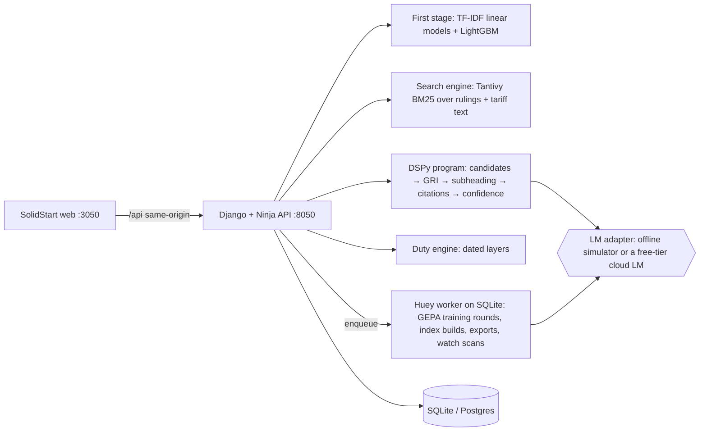

# Tariff Compass

**The right tariff code for US and Canadian imports, with the customs rulings that back it and every duty it will
carry.**

Describe a product (text, a spec sheet or a photo) and Tariff Compass proposes its ten-digit US (HTSUS) and
Canadian (Customs Tariff) codes. Each answer is written like a CBP ruling letter: the holding, the facts it rests
on, the issue, the classification path with the General Rule of Interpretation applied at each step and why each
neighbouring heading was set aside, and numbered citations to real CBP rulings, each compared fact by fact with
your product. A landed-cost receipt lists every duty layer with its rate, amount, source, Chapter 99 number and
effective date. When it isn't sure, it says **Needs a broker** and asks the one fact that would decide it.

Licensed brokers approve, correct or ask; every correction becomes a labelled example for the next training round.
Every product keeps a binder: the reasonable-care record of every code, who decided, why and on what authority.
Nothing is filed automatically.

> Status: foundation. The platform, the classification core and the web app are being built against
> [`docs/API_CONTRACT.md`](docs/API_CONTRACT.md). Measured results will be added here as they are produced.

## Why now

- **De minimis ended for every country on 29 Aug 2025** (EO 14324): every e-commerce parcel into the US now needs
  a formal entry, a code and duty.
- **Duties stack**: MFN + Section 301 + Section 232 (on metal content) + IEEPA duties + fees, each with its own
  Chapter 99 number and date. One heading can change a shipment's duty by thousands of dollars.
- **The importer answers for it**: reasonable care under 19 U.S.C. 1484, records for five years under 19 CFR Part 163;
  in Canada, corrections within 90 days of reason to believe and records for six years.

See [`docs/PROBLEM_STATEMENT.md`](docs/PROBLEM_STATEMENT.md).

## Architecture



Details, latency budgets and the module map: [`docs/ARCHITECTURE.md`](docs/ARCHITECTURE.md). Decisions:
[`docs/adr/`](docs/adr/).

## Quick start

Requirements: Python 3.13, Node 21.7.1, `libomp` on macOS (`brew install libomp`). No Docker, no accounts, no keys.

```bash
make setup        # venv + pinned lock, web app (npm ci), .env, migrate, seed
make fetch-data   # optional: ~18k CBP rulings, the HTS and Canada's T2026 into data/ (offline fixtures are committed)
make api          # http://127.0.0.1:8050/health
make worker       # background jobs
make web          # http://127.0.0.1:3050
```

`make dev` runs the API, the worker and the web dev server together; `make stop` stops everything. The app believes
it is **Thursday 19 February 2026** (`TARIFF_COMPASS_DEMO_TODAY`); every response carries `X-Tariff-Compass-Now`.

Optional live language model: set `LLM_FAKE=false` and a free-tier key (`GROQ_API_KEY`, `GEMINI_API_KEY` or
`OPENROUTER_API_KEY`) in `.env`. Without one, a deterministic offline simulator runs the whole program, GEPA
included, and every number it produces is labelled as such.

## Development

| Task | Command |
|---|---|
| Tests | `make test` (backend pytest + web type check, Vitest, build) |
| Lint | `make lint` (ruff) |
| Toolchain smoke | `make smoke` (DSPy + GEPA offline, Tantivy, scikit-learn, LightGBM, Optuna, MLflow, Huey) |
| Train the first stage | `make train` |
| Run a training round | `make optimize` |
| Evaluation gates | `make eval` → `eval/RESULTS.md` |

## Data

CBP rulings (public domain US government works) via a public CROSS mirror, the USITC HTS, CBSA's Customs Tariff
T2026, and 33 duty layers verified against primary sources as of 19 Feb 2026. Sources, licences, label quality and
the seed plan: [`docs/DATA.md`](docs/DATA.md).

## Screenshots

_To be added._

## Results

_Measured on rulings the classifier hasn't seen; to be added with `eval/RESULTS.md`._

## Limitations

- Not legal advice and not a binding ruling; a licensed broker approves every code. Designed to support
  reasonable-care record keeping; no compliance certification is claimed.
- Coverage follows the public record: some headings have few rulings.
- Rates and layers are those in force on the snapshot date, each shown with its source; the IEEPA duties' legal
  status was open on that date and is shown as such.

## Licence

MIT © Moeiz Shahzad
