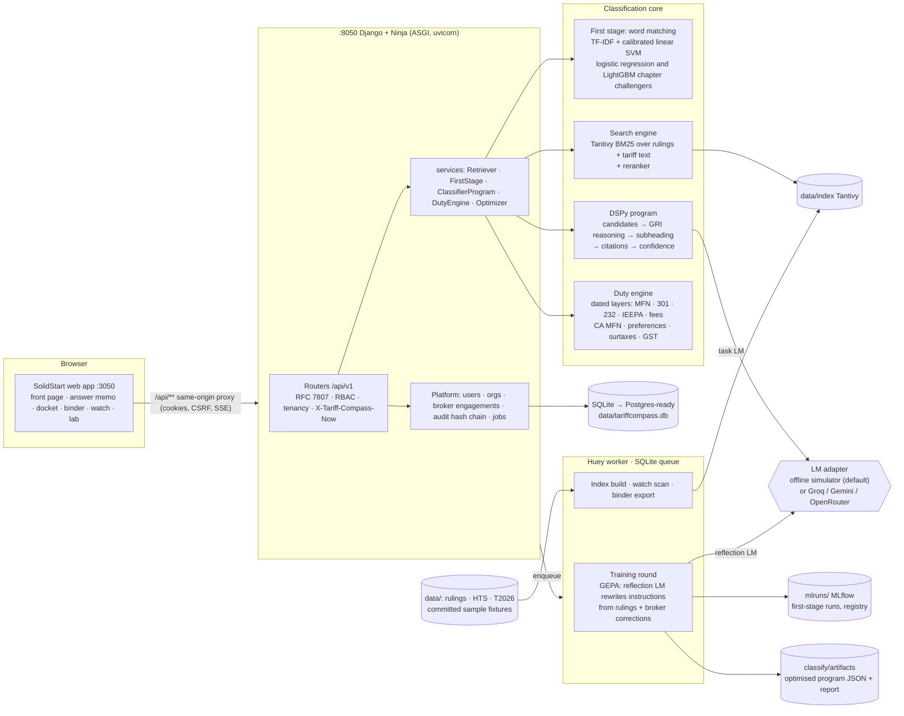

# Architecture

Tariff Compass is a Django 5.2 + Django Ninja API, a Huey worker on SQLite, a Tantivy search engine, a classical
first stage, a DSPy program optimised with GEPA, and a SolidStart web app. It runs on one laptop with no Docker and
no keys; every cloud call has a deterministic offline fake.

## Request path: one classification

1. `POST /api/v1/classify` with text, origin, countries and any evidence ids (spec sheet text from pypdf, photo
   facts from the vision adapter).
2. **First stage** (CPU, in process): TF-IDF features → the calibrated linear SVM (chosen on validation over logistic
   regression; LightGBM, which ranks chapters only, stayed a challenger) → top-k chapters and headings with
   probabilities and the words that drove them.
3. **Search engine**: BM25 over rulings restricted to the candidate headings (plus contrast rulings from
   neighbouring headings), BM25 over the tariff text of those headings; rerank by heading agreement, recency and
   status (a revoked ruling is never cited as support).
4. **Program** (DSPy), when a training round is live (the Lab decides; until one is, word matching answers with
   the closest ruling's line under its top heading and a calibrated confidence word): five modules in order: CandidateHeadings → GriReasoning → ChooseSubheading (US and CA) →
   SelectCitations → Confidence. The output is a `ProgramAnswer` (contracts.py): codes, verdict, facts with their
   sources, the path with the GRI per step and the neighbours set aside, sentences with citation numbers, and the
   deciding question when unsure.
5. **Duty engine**: for each country and the shipment, the layers in force on the snapshot date, stacked, each line
   with a source and an effective date; layers that don't apply are listed with why.
6. The API stores an immutable `Answer` snapshot (with the classifier round, first-stage version and LM label),
   records an audit event, and returns `AnswerOut`. Always-review rules and the verdict decide whether a review
   item is opened. Nothing is filed.

## Latency budgets (offline fakes; the eval harness measures them)

| Stage | Budget (p95) | Notes |
|---|---|---|
| First stage | **< 150 ms** | sparse TF-IDF + pruned linear SVM; under 1 ms at p95 in `make eval` |
| Search (rulings + tariff text) | < 120 ms | Tantivy, in-process, index memory-mapped |
| Program, offline simulator | < 400 ms | five predictor calls, deterministic |
| Duty engine | < 30 ms | pure Python over ~35 dated layers |
| **Full answer with fakes** | **< 1 s** | `POST /classify` end to end, including persistence |
| Full answer with a cloud LM | < 6 s | five calls to a free-tier LM; cached by prompt |

## Processes and ports

| Process | Port | Command |
|---|---|---|
| API (ASGI) | 8050 | `make api` (uvicorn `tariffcompass.asgi:application`) |
| Worker | none | `make worker` (`manage.py run_huey`, one thread; heavy jobs run one at a time) |
| Web | 3050 | `make web` (production build, `node .output/server/index.mjs`) or `make web-dev` |
| Reserved | 8051–8054 | not used |

## Cross-cutting decisions

- **Typed API.** Django Ninja with Pydantic schemas (`api/schemas`), camelCase on the wire via `Wire` /
  `WireRouter`, a label next to every code, RFC 7807 problem documents for every error (ADR 0002).
- **Tenancy.** Every domain row belongs to an organisation. Broker firms act inside an importer's organisation
  through an `Engagement` and a broker membership, so a broker sees only the clients they serve; cross-tenant ids
  return 404, never 403.
- **RBAC.** Roles importer, broker, compliance and admin map to permissions in `platform/roles.py`; views check
  permissions, never role names. Promotion of a training round needs two `lab:sign` signatures by two people.
- **Audit.** An append-only SHA-256 chain per organisation (`platform/audit.py`). Binder versions point at their
  audit event; the short fingerprint appears on screen and on every exported page.
- **Demo clock.** `clock.py` is the only source of "now". `TARIFF_COMPASS_DEMO_TODAY` (default 2026-02-19) and the
  optional `TARIFF_COMPASS_DEMO_TIME` shift Django's `timezone.now`, shared across processes through
  `data/demo-clock.json`. Every response carries `X-Tariff-Compass-Now`; the web app keeps the offset.
- **Dated data.** Duty layers, tariff editions and ruling statuses carry effective dates and sources, so a legal
  change (for example the pending IEEPA case) is a data change, not a code change (ADR 0005).
- **Jobs.** Huey with SQLite storage; each user-visible job has a `Job` row followed by polling or SSE (ADR 0004).
- **Offline first.** LM, vision and embeddings go through adapters with deterministic fakes; live calls are opt-in
  with free-tier keys (ADR 0003).

## Module map and ownership

| Area | Path | Owner |
|---|---|---|
| Settings, URLs, core plumbing, clock | `backend/tariffcompass/{settings,urls,asgi,clock,codes}.py`, `core/` | shared (change by agreement) |
| Interfaces between the core and the platform | `backend/tariffcompass/contracts.py`, `services.py`, `fakes.py` | shared (change by agreement) |
| Wire schemas and labels | `backend/tariffcompass/api/schemas/`, `api/labels.py` | shared (change by agreement, with docs/API_CONTRACT.md) |
| Platform: auth, orgs, roles, tenancy, audit, jobs | `platform/`, `jobs.py` | Platform & API |
| API routers | `api/routers/`, `api/app.py` | Platform & API |
| Products, binder, exports | `catalog/` | Platform & API |
| Review queue, always-review rules | `review/` | Platform & API |
| Watch | `watch/` | Platform & API |
| Lab persistence, sign-off | `lab/` | Platform & API |
| Seed, reset | `seed/` | Platform & API |
| Search engine | `search/` | Classification core |
| First stage, DSPy program, GEPA rounds, simulator policies | `classify/`, `adapters/lm_sim.py` policies | Classification core |
| Duty engine and layer data | `duties/` | Classification core |
| Evaluation harness | `eval/` | Classification core |
| Web app | `frontend/` | Web app |
| Data fetchers and fixtures | `scripts/fetch_data.py`, `scripts/make_fixtures.py`, `search/fixtures/` | Classification core |
| Makefile, CI, docs | `Makefile`, `.github/`, `docs/`, `README.md` | shared |

## What runs where on an 8 GB laptop

- Backend venv ~570 MB (scipy, scikit-learn, LightGBM, MLflow-skinny, DSPy; no PyTorch). Web `node_modules`
  ~290 MB. Rulings ~100 MB in `data/`.
- Peak memory: the toolchain smoke (index + four models + Optuna + MLflow + Huey) peaks at ~240 MB. A training
  round and the API never run at the same time as a frontend build on the reference machine.
